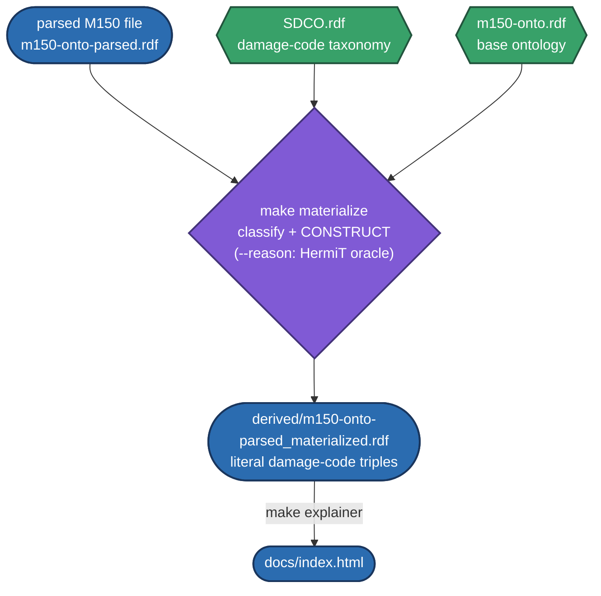

# SDCO — Sewer Damage Classification Ontology

An OWL ontology formalizing **DIN EN 13508-2**, the European coding system for visual inspection of drains/sewers (damage, characterization, inventory/observation codes — ~80 codes total). Source standard: `docs/DIN EN 13508-2 ENGLISH.pdf`.

SDCO complements [m150-onto](../m150-onto), a sibling ontology modeling the DWA M150 data-exchange format (pipe sections, nodes, inspection/condition reports as OWL individuals). Where m150-onto stores condition-report data as literal codes (`hasConditionCode "BAB"`), SDCO gives those codes semantic meaning as a damage-code class taxonomy (`:BAB` ⊑ `Fissure`, etc.) via `owl:imports`, resolved locally through `catalog-v001.xml`.

Full design narrative, competency questions, and SPARQL/SHACL examples: `docs/design-specs/Sewer Damage Classification Ontology SDCO.md`.

## Quick start

```bash
uv sync                                    # rdflib, owlready2, pytest
make materialize DATA=<parsed M150 file>   # default: ../m150-onto/m150-onto-parsed.rdf
make explainer                             # rebuild docs/sdco_data.json and docs/index.html
make test                                  # fast pytest tier; make test-reasoner needs a JDK
```

Run `make` for the full target list (use `PYTHON=.venv/bin/python` if the venv is not active).

## Repository layout

- `SDCO.rdf` — the ontology (Turtle syntax despite the `.rdf` extension).
- `catalog-v001.xml` — OASIS XML catalog (relative paths) resolving `owl:imports` to the sibling `../m150-onto/m150-onto.rdf`.
- `derived/` — generated output only (materialized triples). Never hand-edit; regenerate with `make materialize`.
- `docs/` — design docs (`docs/design-specs/`), the DIN EN 13508-2 standard, and the explainer (`index.html`, `template.html`, `sdco_data.json`).
- `scripts/pipeline/` — materialization and explainer build; `scripts/authoring/` — generators that edit `SDCO.rdf` and their CSV inputs (see `scripts/README.md`).
- `tests/` — pytest suite, including the script self-checks.

## Modeling approach

Damage codes are modeled as **OWL classes** (branch `dev-classes_approach`), not individuals: `owl:equivalentClass` matches literal condition-report codes, and `rdfs:subClassOf` restrictions use `owl:someValuesFrom` to place damage-code classes into their taxonomy. This lets HermiT-style subsumption reasoning work automatically without punning.

## Class hierarchy

```
owl:Thing
├── Observation                — root of all coded findings
│   ├── Cause                  — why a defect/observation occurred (mechanical, chemical, equipment failure...)
│   ├── Defect                 — anything wrong found during inspection
│   │   ├── OperationalDefect  — functional problems (blockages, infiltration, roots, deposits...)
│   │   └── StructuralDefect   — physical damage to the pipe/node fabric (cracks, deformation, collapse...)
│   ├── Inventory               — non-defect features recorded for the asset (connections, node type, repairs)
│   ├── Location                — positional qualifiers for a finding
│   ├── Orientation             — clock-position/directional qualifiers (left, down, circumferential...)
│   └── OtherObservation        — miscellaneous codes DIN EN 13508-2 buckets as "Other" (photos, remarks, termination...)
└── Reference                   — DIN EN 13508-2 damage/feature codes themselves (BAA, BBA, DAB, ...)
    ├── NodeFabric               — structural/fabric condition codes for nodes (manholes, inspection chambers)
    ├── NodeInventory             — inventory/feature codes recorded for nodes (type, dimensions, materials)
    ├── NodeOperation             — operational condition codes for nodes (blockages, deposits, infiltration)
    ├── NodeOther                 — miscellaneous node codes DIN EN 13508-2 buckets as "Other"
    ├── PipeFabric                — structural/fabric condition codes for pipe sections
    ├── PipeInventory             — inventory/feature codes recorded for pipe sections (connections, linings, repairs)
    ├── PipeOperation             — operational condition codes for pipe sections
    └── PipeOther                 — miscellaneous pipe codes DIN EN 13508-2 buckets as "Other"
```

Each `Reference` code class (e.g. `:BAA`) is `owl:equivalentClass` to a literal `hasConditionCode` value and `rdfs:subClassOf` a `someValuesFrom` restriction pointing into the `Observation` tree above (e.g. `:BAA` ⊑ `hasPipeFabricDamage some :Deformation`) — that's how a raw code gets its semantic meaning. The full code list isn't reproduced here; see `SDCO.rdf` or `docs/design-specs/Sewer Damage Classification Ontology SDCO.md`.

> Classes imported directly from `m150-onto` (e.g. `ConditionReport`, individuals for pipe sections/nodes) aren't part of this hierarchy — see the sibling [m150-onto](../m150-onto) repo for those.

## Data pipeline: parsed M150 file → materialized triples



The parsed file comes from the sibling [m150-onto](../m150-onto) repo (`python -m ontoparser.parser --input <file.xml>`, which creates `PARSED_`-prefixed individuals and `owl:imports` the base ontology). `someValuesFrom` restrictions are existential, so reasoning alone never yields a literal, queryable triple for the filler; `scripts/pipeline/materialize_object_properties.py` closes that gap. It merges SDCO.rdf, the m150-onto base ontology (resolved via `catalog-v001.xml`) and the parsed file, realizes each individual's damage-code classes, and emits the filler triples.

```bash
make materialize DATA=path/to/parsed.rdf
```

By default it forward-chains the `equivalentClass` patterns directly (seconds). Pass `--reason` to the script to run the original HermiT path via `owlready2` as a correctness oracle (minutes+).

## Explainer

`docs/index.html` is a self-contained HTML walkthrough of the ontology, built from real data (not hand-typed numbers). `scripts/pipeline/build_explainer.py` (`make explainer`) extracts stats/examples from `SDCO.rdf` + the m150 example dataset into `docs/sdco_data.json`, then injects that JSON into `docs/template.html` to produce `docs/index.html`.

Don't open `index.html` via `file://` — browsers treat `file://` pages as unique security origins, which breaks things. Serve it over localhost instead:

```bash
cd docs
python -m http.server 8000
```

Then visit `http://localhost:8000/index.html`.

See `CLAUDE.md` for full agent-facing context, including current namespace state, working notes, and script details.
